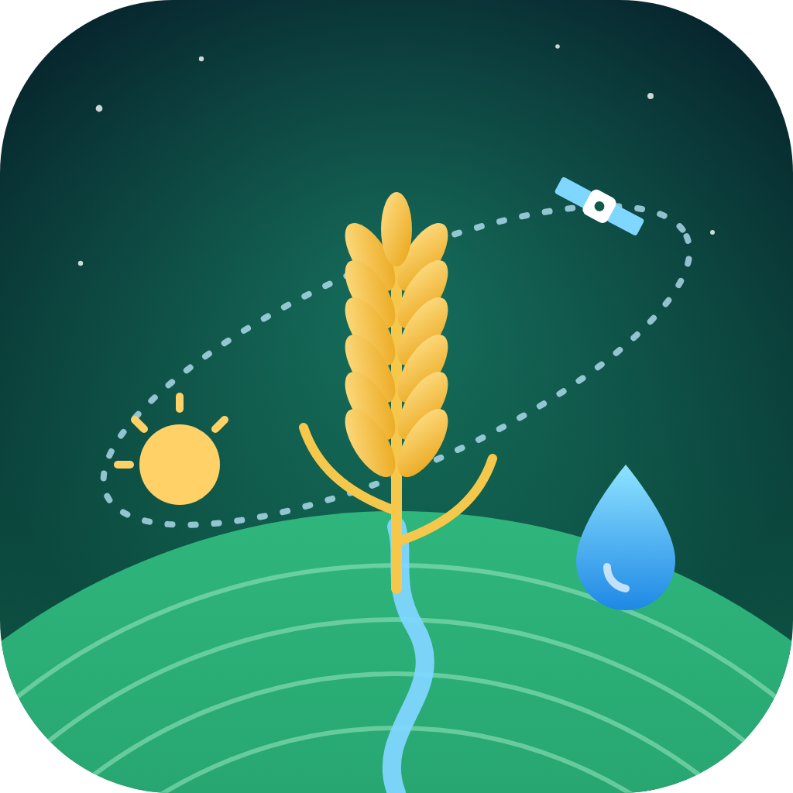
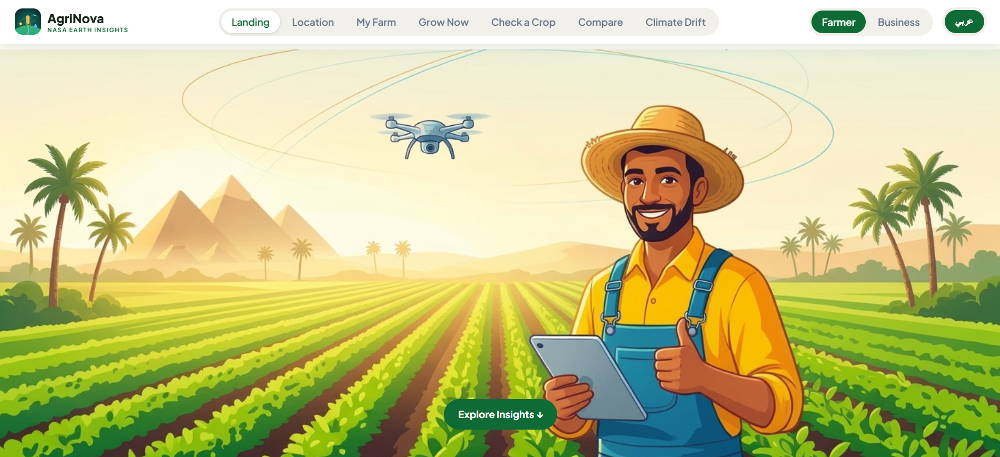
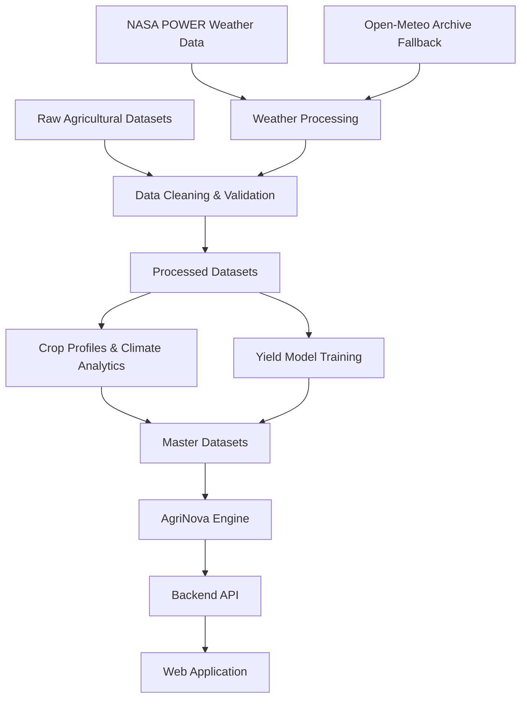

# 🌱 AgriNova | NASA Earth Insights

<p align="center">
  
</p>

<h3 align="center">Turning Earth & Climate Data into Smarter Agricultural Decisions</h3>

<p align="center">
  <strong>An intelligent agriculture insights platform powered by climate data, data engineering, and machine learning.</strong>
</p>

<p align="center">
  
  
  
  
</p>

---

## 🌍 Project Overview

**AgriNova** is a data-driven agricultural insights platform designed to help farmers and agricultural decision-makers make more informed decisions using environmental data and machine learning.

Agriculture is highly sensitive to climate conditions. Temperature, rainfall, humidity, and changing weather patterns can significantly influence crop suitability and agricultural productivity.

AgriNova brings together multiple data sources, transforms raw environmental and agricultural data into structured datasets, and applies analytical and machine learning techniques to deliver useful agricultural insights.

The platform focuses on connecting **climate intelligence with agricultural decision-making**, with an emphasis on Egyptian locations.

## 🖥️ Platform Preview

<p align="center">
  
</p>

<p align="center">
  <em>AgriNova — NASA Earth Insights</em>
</p>

## ✨ Platform Features

The platform interface brings together several agricultural insight modules:

| Module | Description |
|---|---|
| 📍 Location | Explore agricultural and climate insights by location. |
| 🌾 My Farm | A dedicated farmer-oriented experience. |
| 🚀 Grow Now | Access crop-growing insights and recommendations. |
| 🔍 Check a Crop | Explore crop-related suitability information. |
| ⚖️ Compare | Compare agricultural and climate-related indicators. |
| 🌡️ Climate Drift | Explore changes between historical baseline and recent climate conditions. |
| 👨‍🌾 Farmer / Business | Different platform experiences for farmers and business users. |
| 🌐 Arabic / English | Bilingual interface experience. |

## 🧠 What Makes AgriNova Different?

AgriNova is not just a dashboard displaying weather information.

It combines several stages of a data science workflow:

- **Data Collection:** Gathering weather and agricultural datasets.
- **Data Cleaning:** Validating, normalizing, and preparing heterogeneous datasets.
- **Data Engineering:** Building structured datasets and analytical tables.
- **Machine Learning:** Training predictive models for agricultural use cases.
- **Climate Analytics:** Comparing historical and recent climate patterns.
- **Application Layer:** Making insights accessible through a web interface and backend API.

## ⚙️ Data Engineering Pipeline

The project follows a multi-stage pipeline that transforms raw datasets into application-ready outputs.



### Pipeline Stages

| Script | Responsibility |
|---|---|
| `01_fetch_weather.py` | Fetches daily weather data for configured Egyptian locations, using NASA POWER as the primary source and Open-Meteo Archive as a fallback. |
| `02_clean_and_merge.py` | Cleans and validates source datasets, builds crop profiles, and generates climate analytics. |
| `03_train_model.py` | Trains and evaluates yield regression models. |
| `03b_retrain_selected.py` | Retrains the selected model. |
| `04_build_master.py` | Builds structured master datasets. |
| `05_validate_master.py` | Validates master dataset outputs. |
| `06_build_crop_traits.py` | Builds crop trait information. |
| `07_build_crop_knowledge.py` | Builds crop knowledge outputs. |
| `09_engine.py` | Provides the central agricultural insights and recommendation engine. |
| `10_crop_classifier.py` | Handles the crop classification component. |

## 🤖 Machine Learning & Intelligence

AgriNova includes multiple analytical and machine learning components, each serving a different purpose.

### 1. Crop Classification

The crop classification component uses agricultural input features to support crop classification.

The trained classifier is stored in:

`data/processed/crop_classifier.joblib`

### 2. Yield Prediction

A regression component designed to estimate crop yield from the available agricultural features.

The training workflow:
- Prepares categorical and numerical features.
- Handles missing values.
- Encodes categorical variables.
- Evaluates Ridge Regression and Random Forest.
- Selects the model with the lower Mean Absolute Error (MAE).
- Saves the selected model and evaluation metrics.

Model artifact:

`data/processed/yield_model.joblib`

### 3. Climate Fit Score

A prototype analytical score that compares recent location conditions with crop profile statistics.

It uses available indicators such as:
- Temperature.
- Humidity, when available.
- Crop-specific statistical profiles.

The score helps explore how closely recent climate conditions align with the available crop profile data.

### 4. Climate Drift Analysis

Compares historical baseline temperatures with recent temperatures by location and month.

The resulting analysis helps identify temperature changes over time.

Output:

`data/processed/climate_drift.csv`

> **Important:** These components are decision-support prototypes. Their outputs should not be treated as guaranteed agricultural outcomes or a substitute for professional agronomic advice.

## 📊 Data Sources & Processing

The project works with multiple agricultural and environmental datasets, including:

- NASA POWER weather data.
- Open-Meteo Archive as a weather fallback.
- Crop Recommendation dataset.
- Agricultural yield dataset.
- FAO-related yield reference data.
- Rainfall, temperature, and pesticide reference datasets.

### Data Engineering Principles

- Normalize column names and data types.
- Remove exact duplicate records where appropriate.
- Validate dates and location coverage.
- Generate cleaning and validation reports.
- Preserve datasets with different levels of detail instead of performing unsupported row-level joins.
- Normalize known crop-name aliases.
- Keep track of unmatched crop labels.

## 🛠️ Technology Stack

| Area | Technologies |
|---|---|
| Programming | Python |
| Data Processing | Pandas, NumPy |
| Machine Learning | Scikit-learn |
| Model Persistence | Joblib |
| Weather Data | NASA POWER, Open-Meteo Archive |
| Backend | Python API |
| Frontend | HTML, CSS, JavaScript |
| Data Storage | CSV, JSON, serialized ML models |
| Version Control | Git & GitHub |

## 📁 Project Structure

```text
AgriNova/
│
├── backend/
│   ├── README_AR.md
│   ├── config.py
│   ├── egypt.py
│   └── requirements.txt
│
├── data/
│   ├── raw/
│   ├── processed/
│   │   └── master/
│   └── final/
│
├── pipeline/
│   ├── NASA_Pipeline.jpg
│   └── pipeline.png
│
├── web/
│   ├── index.html
│   ├── logo.jpg
│   └── hero.jpg
│
├── 01_fetch_weather.py
├── 02_clean_and_merge.py
├── 03_train_model.py
├── 03b_retrain_selected.py
├── 04_build_master.py
├── 05_validate_master.py
├── 06_build_crop_traits.py
├── 07_build_crop_knowledge.py
├── 09_engine.py
├── 10_crop_classifier.py
│
├── api.py
├── config.py
├── egypt.py
├── requirements.txt
├── run_server.bat
├── test_api.py
├── PROJECT_STATUS.md
└── README.md
```

## 🚀 Getting Started

### Prerequisites

- Python 3.10 or later.
- pip.
- Git.
- Internet connection for fetching weather data.

### 1. Clone the Repository

```bash
git clone https://github.com/shahdfarghaly37/AgriNova.git
cd AgriNova
```

### 2. Create a Virtual Environment

```bash
python -m venv .venv
```

Activate it:

**Windows:**

```powershell
.venv\Scripts\activate
```

**Linux / macOS:**

```bash
source .venv/bin/activate
```

### 3. Install Dependencies

```bash
python -m pip install --upgrade pip
pip install -r requirements.txt
```

### 4. Run the Data Pipeline

Run the pipeline scripts from the project root in the required order:

```bash
python 01_fetch_weather.py
python 02_clean_and_merge.py
python 03_train_model.py
python 04_build_master.py
python 05_validate_master.py
python 06_build_crop_traits.py
python 07_build_crop_knowledge.py
```

The pipeline produces processed datasets, analytical outputs, and model artifacts under `data/processed/` and related output folders.

### 5. Run the Application

On Windows, the repository includes:

```powershell
.\run_server.bat
```

The backend entry point is `api.py`.

> Run the application from the project root so that configured data and model paths resolve correctly.

## 📦 Key Outputs

### Processed Data

- `agri_247k_clean.csv`
- `weather_daily.csv`
- `current_climate.csv`
- `climate_drift.csv`
- `fit_scores.csv`
- `crop_traits.csv`
- `crop_knowledge.csv`

### Master Datasets

- `master_training.csv`
- `master_weather_monthly.csv`
- `master_location_crop.csv`
- `data_dictionary.csv`

### Machine Learning Artifacts

- `crop_classifier.joblib`
- `yield_model.joblib`
- `metrics.json`
- `classifier_metrics.json`
- `feature_importance.csv`

## ⚠️ Data & Model Limitations

Transparency is an important part of responsible data science.

- The 247K yield dataset is treated as synthetic/unverified according to the project documentation. Its evaluation metrics do not establish real-world prediction accuracy for Egyptian farms.
- The yield dataset contains five crop labels, while the Crop Recommendation dataset contains 22. Only matching crop names can receive the corresponding crop-profile features.
- Reference datasets such as FAO yield, rainfall, temperature, and pesticide data have different data grains and are not blindly merged.
- Recent NASA rainfall measurements are not automatically equivalent to rainfall features in the yield training dataset.
- Climate Fit Score uses prototype statistical indicators and should not be interpreted as crop-specific agronomic advice.
- Humidity-based fit calculations are omitted when humidity is unavailable.

## 🔮 Future Improvements

Potential directions for further development include:

- Integrating additional verified agricultural datasets.
- Improving model validation with real farm-level observations.
- Expanding crop coverage and crop-specific agronomic knowledge.
- Improving climate suitability indicators with validated crop-specific thresholds.
- Adding more explainability and model monitoring.
- Expanding the platform's location and user-specific insights.

## 👥 Team

**Farmer Imposters**

Developed as an agricultural data science project focused on combining climate intelligence, data engineering, machine learning, and an accessible web experience.

## 🌱 Our Vision

> Making agricultural data more accessible, understandable, and useful — one smarter decision at a time.

---

<p align="center">
  <strong>AgriNova | NASA Earth Insights</strong><br/>
  <em>Smarter Insights. Better Decisions. Sustainable Agriculture.</em>
</p>
